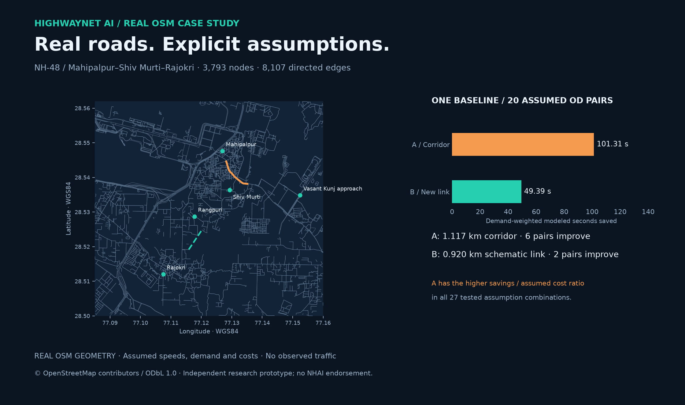
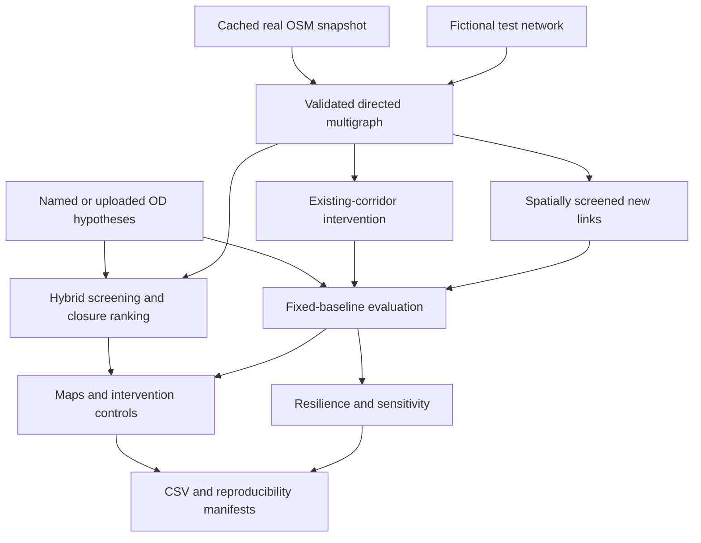

# HighwayNet AI
### Road Network Bottleneck & Infrastructure Optimization

An independent geospatial research prototype that ranks structural bottlenecks,
tests corridor disruption, and compares existing-road improvements with
hypothetical connections under the same explicit demand assumptions.

**v0.2 includes a real OpenStreetMap case study:** NH-48 around
**Mahipalpur–Shiv Murti–Rajokri**, with Rangpuri and the western Vasant Kunj approach.
Built by **Ayushditya Ranjan · Mathematics & Computing, DTU**.

**Real roads; modeled traffic conditions.** No measured traffic demand, congestion
labels, engineering costs or construction recommendations are claimed. This is
an independent student project, with no NHAI affiliation or endorsement. “AI” is
the project name; this version implements graph analysis and scenario simulation,
not a trained traffic predictor.



## Run the app

Install [uv](https://docs.astral.sh/uv/getting-started/installation/), extract or
clone the project, and run:

```bash
uv python install 3.11
uv sync --frozen
uv run streamlit run app.py
```

The bundled real-road snapshot and fictional demo both work offline after
installation. No API key or map tile connection is needed. The app defaults to
the real snapshot. Python 3.11 and 3.12 are supported; exact packages are locked.

The interface provides four workspaces:

1. **Network & routes:** road geometry, named OD routes, ranked links, map road
   selection, anchor positions and component-level score inspection.
2. **Intervention lab:** connected treatment corridor, optional reverse arcs,
   speed or assumed junction-delay treatment, bounded new-link search, and
   side-by-side comparison with downloadable CSV/JSON.
3. **Resilience & uncertainty:** corridor disruption, usable primary-route
   alternatives, 27 assumption experiments, and boundary-exposure flags.
4. **Evidence & method:** source provenance, assumptions, external routing checks
   and validation of user-supplied timestamped route observations.

## Real case study: what was actually measured

The OSM road graph contains **3,793 road nodes and 8,107 directed edges** within
77.085–77.160°E, 28.500–28.562°N. It preserves mapped one-way directions,
parallel links, curved road geometry and 25 mapped signal nodes. The snapshot
was obtained on **22 October 2026** using four sequential bounded OSM API tiles.
Raw road XML, GraphML, request records, timestamps and checksums are included.

Five approximate area anchors are snapped to junctions with at least three
unique road neighbors, within 500 m. Every offset is exported. All **20 ordered
OD pairs** are reachable. These are assumed trips between areas, not surveyed
traffic or verified building entrances.

**Fixed balanced/uncongested example:**

| Measure | A: upgrade an existing route corridor | B: add the selected hypothetical link |
|---|---:|---:|
| Weighted modeled seconds saved | 101.31 | 49.39 |
| Savings on common reachable OD time | 0.988% | 0.482% |
| Improved OD pairs | 6 / 20 | 2 / 20 |
| Assumed total arbitrary cost units | 100.00 | 459.82 |
| Weighted seconds / assumed cost unit | 1.013 | 0.107 |
| Demand with ≥2 directed edge-disjoint routes | 30% | 60% |

Baseline topological redundancy is 30%. **No baseline or selected scenario has
a primary-route-disjoint alternative within 1.5× primary route time** for these
ODs. That negative result is retained. Reachability remains 100% in both scenarios.

A treats a contiguous window of 17 directed segments around a ranked link, with
speed ×1.4 and cap 100 km/h. B uses a 919.65 m modeled alignment, 40 km/h,
circuity 1.2 and an assumed 500 units/km. The search evaluated **14 eligible
proposals within a budget of 16**, using conservative endpoint/crossing gates.
These are comparisons within the screened set, not a global optimum or
construction-feasibility finding.

A has the higher benefit-per-assumed-cost ratio in all **27 tested combinations**
of operating model, relative demand hypothesis and B/A cost ratio. This establishes
stability only within those specified assumptions—not superiority for actual
traffic or real project costs.

Three OSRM comparisons provide an external routing plausibility check. They are
**routing estimates**, not observed journeys. The boundary contraction check
retains all 20 OD connections, but the stronger contraction increases some
modeled times by up to **57.97 s**. Small-boundary artifacts remain a material risk.
See [benchmark evidence](docs/BENCHMARKS.md) and [case-study report](docs/CASE_STUDY.md).

## Verification and screenshots

**73 tests pass on Python 3.11 and 3.12; package statement coverage is 90%.**
All tests prohibit unmocked external HTTP. The bundled real snapshot is tested offline,
alongside hand-solvable algorithm, unit, direction, intervention, cache, sensitivity
and Streamlit tests. Browser review exercised real-study loading, map box selection,
and a 390 px mobile viewport without page overflow or JavaScript page errors.

Actual UI captures: [desktop network](docs/screenshots/network_desktop.png),
[intervention controls](docs/screenshots/intervention_controls.png),
[scenario results](docs/screenshots/intervention_desktop.png), and
[mobile layout](docs/screenshots/network_mobile.png).

## Reproduce and inspect

```bash
# Real and fictional v0.2 experiments
uv run highwaynet case-study --source nh48_airport --out results/local/nh48
uv run highwaynet case-study --source synthetic --out results/local/demo

# Offline boundary diagnostic and cached external-routing checks
uv run python scripts/check_boundaries.py
uv run python scripts/check_osrm.py
# Explicitly query the external routing service again
uv run python scripts/check_osrm.py --refresh

# Tests, lint, formatting and packaging
uv run pytest --cov=highwaynet --cov-report=term-missing
uv run ruff check .
uv run ruff format --check .
uv build
```

Case-study outputs include the OD matrix, named routes and edge sequences,
anchor offsets, ranking components, screened/evaluated candidates, scenario and
per-OD results, corridor closures, route alternatives, 27-case sensitivity,
GeoJSON, interactive self-contained HTML maps and a runtime/input manifest.
Open `results/nh48_case/network.html` directly in a browser for the recorded map.

The legacy `highwaynet benchmark` command remains available for small synthetic
fixtures. Existing `results/synthetic/` and `results/synthetic-region/` files are
**historical v0.1 artifacts** and are not evidence for the revised v0.2 ranking.
Current evidence is in `results/nh48_case/` and `results/synthetic_case/`.

## Refresh or import road data

The app uses cached data; it does not trigger a public API request on every visit.
Choose a provider explicitly when refreshing:

```bash
# The provider used for the bundled snapshot: four sequential OSM API tiles
uv run highwaynet fetch --study nh48_airport --provider osm-api --refresh

# Alternative provider; availability varies
uv run highwaynet fetch --study nh48_airport --provider overpass --refresh

# Import a locally exported .osm XML extract with full way-node references
uv run highwaynet import-osm path/to/extract.osm --study nh48_airport
```

No hidden provider switching or Google DNS fallback is used by the new fetch
commands. Requests have explicit bounds and timeouts. Overpass endpoints timed
out during this build; the identified main OSM API succeeded. Refreshing changes
the dataset and can change results. Large areas should use regional extracts or
an appropriately provisioned data provider, rather than the main editing API.

## Methods and architecture



| Module | Responsibility |
|---|---|
| `data.py`, `snapshot.py`, `studies.py` | Units, graph checks, speed assumptions, real data/import/cache and provenance |
| `demand.py`, `analysis.py` | Named demand hypotheses, directed routes, usage, centrality and closures |
| `planning.py` | Farthest-point geographic sampling, conservative gates and candidate evaluation |
| `scenarios.py`, `operating.py` | Non-mutating road changes, operating/delay hypotheses and comparison |
| `resilience.py`, `experiments.py` | Corridor failures, bounded alternatives and 27-case sensitivity |
| `validation.py`, `case_study.py` | Route observations, boundary diagnostics and reproducible study outputs |
| `maps.py`, `app.py` | GeoPandas geometry, Plotly maps, selection controls and Streamlit workflow |

The ranking uses normalized weights 40/35/25 over connectivity importance,
closure detour and lost reachable demand. Connectivity importance averages
normalized time-weighted betweenness and assumed OD route-usage share.
Shortlisting interleaves high-centrality and high-usage edges. Closure detour is
relative time increase, capped at 200% and scaled to 0–1. Weights/caps are design
choices, not fitted transport parameters.

Times use `length_m × 3.6 / speed_kph + modeled_delay_s`. Busy/severe operating
models are explicit assumptions; new links receive the same speed factor.
A speed treatment does not increase modeled road capacity. A separate treatment
can reduce explicitly modeled signal delay. No queue/capacity assignment is
implemented without appropriate inputs.

See the [full model contract](docs/METHODOLOGY.md), [data provenance](data/README.md),
[release review](docs/REVIEW.md), and [interview guide](docs/INTERVIEW_GUIDE.md).

## Supply demand or route observations

OD CSV: `origin,destination,weight`. Use unique non-self ordered pairs, valid
integer node IDs and positive finite weights. The UI accepts 1–120 rows. Weight
units and analysis period must be stated; no daily or annual extrapolation is
justified by the default relative weights.

Observation CSV: `origin,destination,observed_seconds,observed_at,source`.
`observed_at` must include a timezone. Example format:

```csv
origin,destination,observed_seconds,observed_at,source
```

The bundled template deliberately contains **no invented observations**. Supply
appropriately sourced independent data, then use the app or:

```bash
uv run highwaynet validate-routes observations.csv --out results/local/validation
```

The tool reports route-level errors and unmatched/unreachable observations.
It does not infer observed edge speeds from a single aggregate route duration.

## Limits and attribution

No real traffic counts, measured congestion, calibrated capacity model, induced
demand, engineering cost estimate, land-rights check or validated alignment is
included. Conditional OSM access, relation turn restrictions and vehicle-specific
height/weight restrictions remain outside the model. Bounded graph edges and
OSM omissions can create artificial bottlenecks. Approximate anchors and the
conservative access filter need field review.

Topological edge disjointness does not guarantee independent bridges, junctions
or failure zones. The practical alternative check is relative to one selected
primary route, not an exhaustive disjoint-route optimizer. New-link screening
can still propose an alignment through buildings or protected land; positive
modeled benefit is not a recommendation to build it.

Code and authored synthetic data: MIT. OSM raw/derived data: **ODbL 1.0**, ©
[OpenStreetMap contributors](https://www.openstreetmap.org/copyright). The supplied
raw road extract and transformation code support inspection and reproduction.
Public repository creation/publication awaits explicit user approval.
